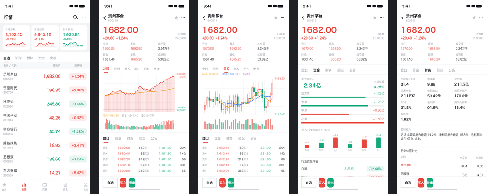

# fimg-agent-plugin

**让 AI Agent 直接在 Figma 画布上画 App 原型。**

一条本地双向链路：Agent 下发声明式 JSON → 本地桥 → Figma 插件渲染成**真实的 Figma 节点**
（Frame / Auto Layout / 文本 / 旋转矩形），并支持把结果**导出 PNG 回传**给 Agent 自检。

> 📌 **接手开发的模型请先读 [`AGENTS.md`](AGENTS.md)** —— 那里有当前状态、强制开发回路和硬性规则。

---

## 为什么需要它

| 路线 | 能否创建原型 | 说明 |
|---|---|---|
| Figma **REST API** | ❌ **只能读** | 可读文件/节点/样式、导出图片、读评论。写操作仅限 Variables（企业版）等少数端点 |
| 官方 **Figma MCP**（Dev Mode） | ❌ 只读 | 设计 → 代码方向，且需要桌面端 |
| 第三方「写操作 MCP」 | ✅ | 本质都是 **插件 + 本地桥**，与本项目架构相同 |
| **本项目** | ✅ | 自研插件 + 零依赖桥，完全可控、可调试、免费版可用 |

---

## 特点

- **零 npm 依赖** —— 桥只用 Node 内置模块，不需要 `npm install`
- **自检回路** —— 插件能把渲染结果导出 PNG 回传落盘，Agent 能「看到」自己画的东西
- **本地预览渲染器** —— 不进 Figma 就能看到画面（0.5 秒），快速迭代不消耗 Figma 往返
- **声明式 DSL** —— 用 JSON 描述界面，改设计 = 改一个 JS 文件
- **带静态校验** —— 无需 Figma 即可查出模型/布局错误

---

## 两种工作模式

| | **① 在现有设计稿上迭代**（主要模式） | ② 从零生成 |
|---|---|---|
| 场景 | 你已有 Figma 设计稿，要我改 | 从零搭一套新界面 |
| 手段 | `dump` 读取 → `patch` / `insert` / `rm` **就地修改** | `render` 用 SPEC_DSL 创建 |
| 特点 | 保留你的图层结构、命名、组件关系 | 完全由规格定义 |
| 文档 | [docs/ITERATING.md](docs/ITERATING.md) | [docs/SPEC_DSL.md](docs/SPEC_DSL.md) |

```bash
# 模式 ①：读 → 改 → 看
./fimg list                                     # 看结构
./fimg dump --name "卡片" --out dumps/c.json  # 读细节
./fimg patch --ops ops.json --dry            # 先看会改什么
./fimg patch --ops ops.json                  # 真改
./fimg export                                   # 导出核对

# 模式 ②：从零生成
./fimg spec && ./fimg check && ./fimg preview
./fimg render --clear
```

> ⚠️ `render` **默认不清空页面**。在现有稿上工作时误清空的代价太大，所以清空必须显式 `--clear`。

---

## 快速开始

### 0. 先自检（推荐）

```bash
./fimg doctor
```

它会逐层检查：运行时 → 文件完整 → 代码语法 → 清单合规 → 逻辑测试 →
规格链路 → 桥 → 环境提示。**哪一层断了就先修哪里。**

> ### ⚠️ 关于命令形式
>
> **本环境里 `npm` 可能不存在**（Node 常以独立运行时形式提供，不带 npm）。
> 所以本项目提供一个不依赖 npm 的统一入口 **`./fimg`**，文档里全部用它：
>
> ```bash
> ./fimg test          # 等价于 node test/plugin.test.mjs
> ./fimg dump --name X # 等价于 node tools/figma.mjs dump --name X
> ```
>
> `./fimg` 会自己解析运行时（node ≥ 18、python 能 `import PIL`），
> 也可用 `NODE_BIN` / `PY_BIN` / `DSH_RUNTIME_ROOT` 覆盖。
>
> `package.json` 里也保留了 npm scripts，**如果你有 npm，两种写法都能用**。
> `./fimg help` 看全部子命令。

### 1. 启动本地桥

```bash
./fimg bridge
```

桥监听 `localhost:8787`（双栈，IPv4+IPv6 都通）。保持它常驻。

> ⚠️ **每次开新会话都要重新启动桥** —— 它是前台常驻进程，会话结束就没了。
> 用 `./fimg status` 确认它在跑。

### 2. 在 Figma 里导入插件

1. 打开 Figma 桌面端 → 新建或打开一个 **Design 文件**（不能是 FigJam）
2. 顶部菜单 `Plugins` → `Development` → **`Import plugin from manifest…`**
3. 选择本仓库的 `plugin/manifest.json`
   （macOS 文件选择器里按 `⌘⇧G` 可直接粘贴完整路径，见下方）
4. 再走 `Plugins` → `Development` → **`FIMG Agent Plugin`**

插件面板显示 **● 已连接 · 待命** 即成功。

> 完整路径：
> ```
> /Users/oyx/project/fimg-agent-plugin/plugin/manifest.json
> ```

### 3. 试一下

```bash
./fimg test                            # 29 个单元测试（不需要 Figma，秒级）

./fimg ping                        # 确认插件在线
./fimg list                        # 看你画布上的结构
./fimg sel                         # 读你当前选中的节点
./fimg dump --sel --out dumps/sel.json   # 读成结构化 JSON

./fimg spec && ./fimg check && ./fimg preview   # 从零生成时的本地三步
./fimg render --clear           # 渲染到画布（--clear 才会清空页面）
./fimg export                      # 从 Figma 导出真实截图 → out/
```



---

## CLI 参考

```
node tools/figma.mjs <命令> [选项]

目标页面（所有读写命令通用）
  --page 名称            指定页面；不指定则用 Figma 的「当前页」
  DSH_FIGMA_PAGE=名称    等价于一直带 --page
  ⚠ 读操作（stats/list/dump）绝不会新建页面；render 只在显式给页名时才新建。

读取与定位
  status                 桥与插件状态（含渲染进度）
  ping                   与插件握手，返回文件名/页面列表
  stats   [--page 名称]  目标页的顶层 Frame 与节点总数
  styles                 列出本文件的本地样式（文本/颜色/效果）
  list   --depth 6       树状大纲（快速定位，每行带 #id）
  sel    [--ids a,b]     读当前选区；给了 --ids 则改为设置选区
  dump   [选择器] [--within 容器id] --depth 8 --max 4000 --out dumps/x.json
                        读到 SPEC_DSL 同构的 JSON（带 id，可直接构造 patch）

修改（就地改，不重建节点，保留图层结构）
  patch  --ops ops.json [--dry] [--within 容器id]
                        按选择器批量改属性；--within 给整批加默认范围
         ⚠ op 必须带选择器；要全量修改需在 op 里显式写 "all": true
  insert [spec.json] [--frame 名称] --parent <id> | --parent-name <名称> [--index n]
                                    往现有容器插入新节点
  move   <选择器> --to <父容器id> [--index n]    改顺序 / 跨容器搬移
  dup    <选择器> [--count n] [--to id] [--index n] [--dx d --dy d] [--rename 名称]
                                    复制节点（含整棵子树）
  group  <选择器> [--rename 名称] [--index n]     收进一个 GROUP（须同父容器）
  ungroup <选择器> [--dry]                        解组，子节点原地保留
  rm     <选择器> [--dry]                         删除节点（超过 200 个需 force）

组件与实例
  component <选择器> [--rename 名称] [--dry]      把 FRAME/GROUP 原地转成 COMPONENT
  instance  --of <组件id> | --of-name <组件名> [--parent <id>] [--count n]
            [--index n] [--x n --y n] [--rename 名称]        放置组件实例
  swap   <选择器> --to <组件id> | --to-name <组件名>          换实例的主组件
  detach <选择器> [--dry]                         脱离组件（实例 → 普通 FRAME）

原型交互
  reactions <选择器>                读交互（目标解析成名字）
  link      <选择器> --to <节点> | --to-name <名称> | --url <网址>
            [--trigger ON_CLICK|ON_HOVER|AFTER_TIMEOUT|…]
            [--nav NAVIGATE|SWAP|OVERLAY|SCROLL_TO|CHANGE_TO]
            [--transition SMART_ANIMATE|DISSOLVE|INSTANT|…] [--duration 秒]
            [--append] [--clear] [--dry]        建 / 追加 / 清空交互

渲染与导出
  render [spec.json] [--clear] [--page 名称]
                        渲染规格；**默认不清空页面**，--clear 才清空
  export --all | --names "A,B" [--scale 2] [--prefix shot]
  clear  [--page 名称] --yes        清空页面（危险，必须 --yes）
```

**选择器**（`patch` / `rm` / `move` / `dup` / `group` / `ungroup` 通用）：
`--id` / `--ids` / `--name 通配或正则` / `--text 文案` / `--type 类型` / `--layout V|H`，
再加 `--within <容器id>` 限定范围。

> - `name` 匹配的是**图层名**，`text` 匹配的是**文案内容**。
>   Figma 里文本图层常叫 `Text`，所以按"写着什么"找要用 `text`。
> - `--type` 同时认 DSL 名与 Figma 名（`RECT` = `RECTANGLE`）。
> - 真实稿子里同名图层很多（一堆 `Frame`），**写操作建议总是带 `--within`**。
> - ⚠️ `link`/`swap` 的 `--to` 是「连到哪个节点 / 换成哪个组件」，
>   而 `move`/`dup`/`instance` 的 `--to` 是「放进哪个容器」。同名不同义。

所有导出的 PNG 落在 `out/`，dump 产物落在 `dumps/`。

---

## 内置示例：炒股 App 原型（5 屏）

针对「行情展示 + 个股下方信息展示」的场景：

| # | 屏幕 | 内容 |
|---|---|---|
| 01 | 行情 | 指数卡（含迷你走势线）、板块 Tab、自选股列表（红涨绿跌胶囊）、底部 TabBar |
| 02 | 个股详情 · 分时盘口 | 价格头、分时图（价线/均价线/面积/量能柱）、**盘口五档**、最近成交、买卖操作栏 |
| 03 | 个股详情 · 日K | 真蜡烛图 + MA5/MA10 + 量能柱、盘口 |
| 04 | 个股详情 · 资金流向 | 主力净流入、超大/大/中/小单占比条、近 5 日柱状、行业资金排名 |
| 05 | 个股详情 · 财务指标 | 10 项估值指标网格、盈利能力、同行估值对比 |

配色遵循 A 股约定：**红涨绿跌**。数据均为构造的示意值。

设计代码在 [`specs/build-stock-spec.mjs`](specs/build-stock-spec.mjs)，
改配色/加屏幕/调布局都只需动这个文件。

---

## 目录结构

```
fimg-agent-plugin/
├── AGENTS.md              ★ 后续模型的工作交接（先读这个）
├── plugin/
│   ├── manifest.json      Figma 插件清单
│   ├── code.js            ★ 渲染引擎 + 读取/修改引擎
│   └── ui.html            iframe：HTTP 长轮询客户端
├── bridge/server.mjs      零依赖 HTTP 长轮询桥
├── tools/figma.mjs        CLI 客户端
├── specs/
│   ├── build-stock-spec.mjs  ★ 设计规格生成器
│   ├── validate-spec.mjs     静态校验
│   └── preview.py            ★ 本地预览渲染器
├── test/
│   ├── figma-stub.mjs     ★ Figma API 桩
│   ├── plugin.test.mjs    ★ 29 个单元测试（不需要 Figma）
│   └── fake-plugin.mjs      假插件（验证桥协议）
├── examples/              参考截图
├── scripts/               便捷脚本
└── docs/
    ├── ITERATING.md      ★ 在现有设计稿上迭代（当前主要模式）
    ├── ARCHITECTURE.md    架构与协议
    ├── SPEC_DSL.md        规格 DSL 完整参考
    ├── PITFALLS.md      ★ 已踩过的坑与根因（最有价值）
    ├── TROUBLESHOOTING.md 排错手册
    └── ROADMAP.md         已知问题与后续方向
```

---

## 文档

| 文档 | 内容 |
|---|---|
| [docs/CAPABILITIES.md](docs/CAPABILITIES.md) | **能力与用法总表**：23 个命令、选择器、可改属性、护栏与已知缺口 |
| [docs/REVIEW.md](docs/REVIEW.md) | **审查指南**：代码索引、已验证矩阵、高风险区、如何复现 |
| [AGENTS.md](AGENTS.md) | **后续模型必读**：当前状态、强制开发回路、硬性规则 |
| [docs/ITERATING.md](docs/ITERATING.md) | **在现有设计稿上迭代**：选择器、可改属性、ops 格式、常用配方 |
| [docs/SPEC_DSL.md](docs/SPEC_DSL.md) | 规格 DSL 的完整字段参考与示例 |
| [docs/ARCHITECTURE.md](docs/ARCHITECTURE.md) | 数据流、协议细节、关键设计决策及其权衡 |
| [docs/PITFALLS.md](docs/PITFALLS.md) | 27 个坑的现象 / 根因 / 修法 |
| [docs/TROUBLESHOOTING.md](docs/TROUBLESHOOTING.md) | 症状 → 诊断 → 修复 |
| [docs/ROADMAP.md](docs/ROADMAP.md) | 已知问题、未验证项、扩展方向 |

---

## 许可

内部项目，未指定许可证。
